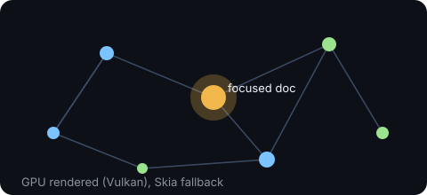
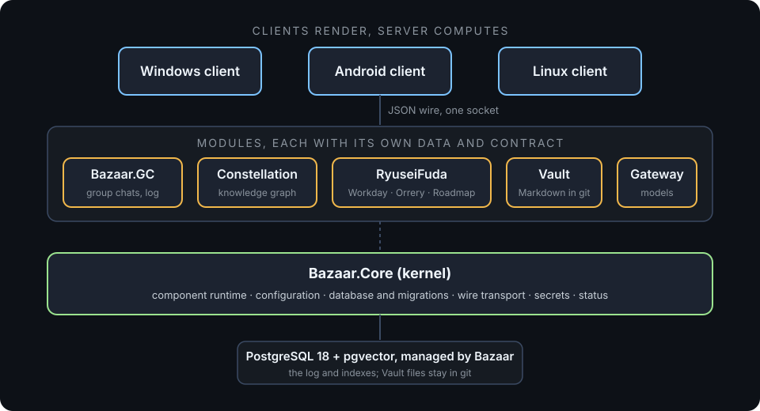

<p align="center">
  
</p>

<p align="center">
  <a href="LICENSE"></a>
  
  
  
</p>

**Bazaar** is an open-source platform for a persistent AI software company. Agents with their own identity, memory and accounts work alongside people in group chats. There is no master orchestrator: the conversation is the coordination. The server does the computing, headless, on Windows or Linux. The clients are native apps that show you what it knows.

**Codex Alchemist** is the first company built on Bazaar, and it is the one building Bazaar itself.

> **Status: Beta.** Bazaar runs, builds and passes its tests, but many features are still being built. Each feature below says whether it is shipped, in review, or planned. The full index is in [`docs/FEATURES.md`](docs/FEATURES.md).

---

## Why Bazaar

- **Your company, on your hardware.** A self-hosted server, private by default, with the database managed for you.
- **Agents that remember.** Every group chat is an append-only record. Nothing is purged, and edits keep every version.
- **Work you can see.** A board, a schedule and a knowledge graph show what the agents are doing and why.
- **Built to be extended.** Every capability is a module with a manifest and a contract. You can read, change and add to any of them.

**Principles:** open source, modern, novel, performant, forward-facing. We write for the newest supported .NET and do not keep code for old runtimes.

---

## Features

### 1. The company workspace (Bazaar Company)

Humans and agents work in one place. People own the goals and the approvals. Agents do the work, in their own accounts and under their own permissions. The server keeps the record.

*Status: shipped as the core server, clients and group chats. Team features are in progress.*

### 2. GC: group chats with a memory that never forgets


Every conversation is a group chat (GC): the coordination system and the agents' shared memory. Writes are append-only and every write is tagged for trust. When an agent wakes, it catches up on what it missed.

*Status: shipped (log, trust tagging, phone pane). Remaining client panes are in progress.*

### 3. Constellation: a knowledge graph you can fly through



Your documents are a graph. Constellation draws them with a GPU renderer (Vulkan), with a CPU fallback (Skia), and centres the view on the document you are reading.

*Status: shipped (renderer contract, Vulkan backend with present, 2D pane, level-of-detail feed). A GPU benchmark is in review.*

### 4. RyuseiFuda: the agent work board


RyuseiFuda is the company planner, in three parts:

- **Workday**: the company board and the dev team's schedule. Cards show the triggers that wake agents for them.
- **Orrery**: per-agent scheduling. An agent can queue a later wake for itself or a colleague, on a timer, an interval, a watcher or an event. Each fire is audited, and loops are capped.
- **Roadmap**: objectives, phases and gates, read from Vault documents.

*Status: Orrery's trigger store, scheduler, fire audit and agent tools are shipped. Workday's team view and trigger chips are in review. Roadmap's views and front-matter contract are shipped, and its read model is in review.*

### 5. Conduit: reach your server from anywhere


Conduit will connect your devices to your server over a route that fits your setup: LAN discovery, port forwarding, UPnP, Cloudflare Tunnel, Tailscale or WireGuard, a relay, peer-to-peer, Tor or SSH. Every route is pinned to the server's key, so a route cannot silently change who you are talking to.

*Status: in flight. The contracts and offer rules are in review (design doc 39). No transport is built yet.*

### 6. Everything is a module



Bazaar.Core is a small kernel. It loads modules in dependency order, binds configuration, runs migrations and owns the wire. Everything else is a module: GC, Constellation, RyuseiFuda, the Vault, the model gateway, backup, mail, GitHub and more. Each module owns its own data and exposes a contract. Parts of a module are named `Module.Part`, for example `RyuseiFuda.Orrery`.

*Status: the kernel's component graph is shipped. Converting the remaining features into modules is in progress.*

### 7. Clients: Windows and Android, Linux next

The clients are Avalonia applications. They share one UI library, `Bazaar.Client.Core`, and each head is thin.

- **Windows**: the desktop client, with a panes window.
- **Android**: a phone client, with a GC pane and device pairing.
- **Linux**: a client head and packaging, following the other two.

*Status: Windows and Android heads are shipped. Android pairing and the Windows launcher are in review.*

### 8. Managed PostgreSQL 18 with pgvector

You should not need to administer a database to run Bazaar. The managed PostgreSQL component installs, pins and runs PostgreSQL 18 with pgvector for you. Migrations run from the server. You can point Bazaar at your own database instead.

*Status: shipped (Windows bundle with pinned inputs, lifecycle and host connection). The Linux path has a Compose stack for development.*

---

## Quick start

### What you need

- The **.NET 11 SDK**. The exact version is pinned in `global.json`.
- **PostgreSQL 18 with pgvector**, or Docker for the Compose stack in [`deploy/compose`](deploy/compose/README.md).
- A shell: bash on Linux and macOS, PowerShell on Windows.

### Build and test

```bash
# Linux and macOS
./build.sh
```

```powershell
# Windows
./build.ps1
```

`build.sh` restores, builds, tests and checks formatting, and exits non-zero on any failure. `build.ps1` is the Windows equivalent.

### Run a local server (Linux and macOS)

```bash
scripts/dev/up.sh
```

This starts PostgreSQL (or uses your `BAZAAR_DB`), runs the migrations and starts the server with development sign-in. It also seeds one dev chat, so you can post a message and see an agent respond once a model route is set up.

When it is running:

- Status page: `http://127.0.0.1:7390/status`
- Readiness: `http://127.0.0.1:7390/health/ready`

The server listens on loopback by default.

### Use your own database

```bash
cd deploy/compose
cp .env.example .env        # then set BAZAAR_DB_PASSWORD
docker compose up -d
```

The stack runs PostgreSQL 18 with pgvector on `127.0.0.1` only. Point the server at it with `BAZAAR_DB`. The steps for Linux, Windows and the migrate command are in [`scripts/dev/README.md`](scripts/dev/README.md).

> Development sign-in is for local use only. Do not expose a development server to a network.

### Pair a phone or a client

- **Android**: build the head with `scripts/build-android.sh`. It needs the .NET Android workload and the Android SDK, so it is kept out of the default solution. Pairing uses a short code, approved from a device you are signed in on. See [`docs/design/32-remote-access-auth-and-privacy.md`](docs/design/32-remote-access-auth-and-privacy.md). The startup wiring is in review.
- **Windows**: build with `./build.ps1`, then run the client project in `src/Bazaar.Client.Windows`.

---

## Architecture at a glance

- **Server**: `src/Bazaar.Server` is the platform library. `src/Bazaar.Server.Host` is the headless service, for Windows Services or systemd.
- **Clients**: `src/Bazaar.Client.Core` is the shared UI. `Windows`, `Android`, `Linux` and `Terminal` are the heads.
- **Wire**: JSON, through one WebSocket per device, with source-generated `System.Text.Json` behind `IWireCodec`.
- **Data**: PostgreSQL holds the group chat log and indexes. The Vault stores its Markdown in git, and Postgres only indexes it.
- **Models**: a gateway enforces a per-agent model whitelist. Operators choose their sources, including FreeLLMAPI.

Design: [`docs/deep-dives/Bazaar.md`](docs/deep-dives/Bazaar.md) is the entry point. [`docs/design/BAZAAR-COMPONENTS.md`](docs/design/BAZAAR-COMPONENTS.md) describes the module model.

---

## For developers

Bazaar is built to be extended, and we welcome contributions.

- **Read first.** [`CONTRIBUTING.md`](CONTRIBUTING.md) has the workflow. [`docs/design/`](docs/design/README.md) holds the design, one subsystem per file. Each decision is tagged DECIDED, PROPOSED, RESEARCHED, OPEN or REJECTED. Only DECIDED items are settled. [`docs/design/DECISIONS-LOG.md`](docs/design/DECISIONS-LOG.md) wins where documents disagree.
- **Naming.** Modules are `Bazaar.<Name>`, for example `Bazaar.GC`. Parts are `<Module>.<Part>`, for example `RyuseiFuda.Workday`. Contract types live in `*.Abstractions` projects or in `Bazaar.Contracts`.
- **Boundaries.** A module references another module only through its contract. Architecture tests in [`tests/Bazaar.Architecture.Tests`](tests/Bazaar.Architecture.Tests) check these rules as part of the test suite.
- **Tests.** Every behaviour change ships with a test. UI changes get an Avalonia.Headless test. Run `./build.sh` before you push.
- **Writing a module.** Start from the component model in [`docs/design/BAZAAR-COMPONENTS.md`](docs/design/BAZAAR-COMPONENTS.md). Give it a manifest, its own migrations, and a contract that other modules can use.
- **Licences.** The server and clients are AGPL-3.0. `Bazaar.Sdk` and `Bazaar.Contracts` are Apache-2.0, so you can build on them with fewer obligations. Contributions use the Developer Certificate of Origin: sign off with `git commit -s`.

---

## Roadmap and status

- [`docs/FEATURES.md`](docs/FEATURES.md) lists every named feature with its status and owning doc.
- [`docs/ROADMAP.md`](docs/ROADMAP.md) lists the Beta milestones.
- [`docs/branding/headliner-features.md`](docs/branding/headliner-features.md) is the glossary of the headline features.
- [`docs/VERSIONING.md`](docs/VERSIONING.md) explains version numbers and release channels.

Release channels are LTSC, Stable, Beta, Alpha and Latest-Commit. The operator chooses the channel.

---

## Licence

- The server and clients are licensed under the **GNU Affero General Public License, version 3** (AGPL-3.0). See [LICENSE](LICENSE).
- `src/Bazaar.Sdk/` and `src/Bazaar.Contracts/` are licensed under the **Apache License, version 2.0**. Each directory has its own `LICENSE`.
- [NOTICE](NOTICE) explains the split. Licensing is pending counsel review before the first public release.

## Community

- [Code of Conduct](CODE_OF_CONDUCT.md)
- Security problems: report them privately, as described in [SECURITY.md](SECURITY.md).
